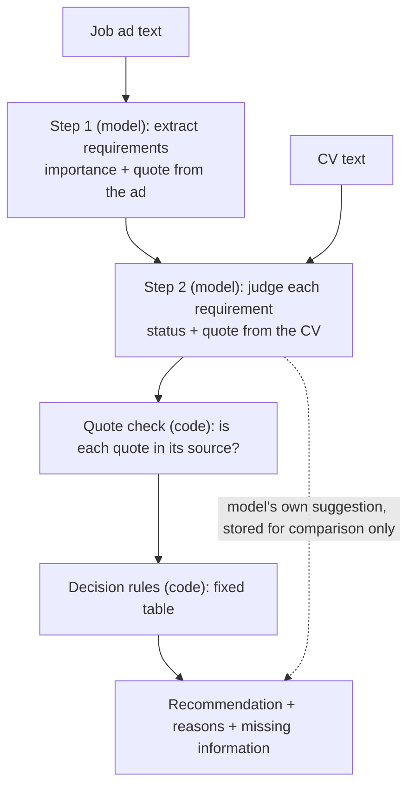

# Design: AI-assisted job-fit assessment

Status: **draft v1 for review**. Nothing in this document is built yet. Sections marked
**Decision needed** are choices for the thesis author; the text gives a recommended
default and the reason for it.

This is activity 2 ("define the objectives for a solution") and the design half of
activity 3 in the design science research process of Peffers et al. (2007). The state
of the system before this work is recorded in [`docs/thesis/BASELINE.md`](../docs/thesis/BASELINE.md).

## 1. Decision problem

- **Who decides:** a recent IT graduate looking for a junior IT job.
- **The decision:** should I prioritise this vacancy?
- **The alternatives:** High Priority, Consider, Low Priority.
- **Why it is hard:** job ads list many skills without saying which are essential, and
  ask for "relevant experience" that is hard to judge when most of a graduate's
  experience comes from university projects.
- **What the system does:** it explains how the CV matches the ad, points out what is
  missing or unclear, and gives a recommendation with reasons. The choice stays with
  the job seeker.

The existing rule-based matcher answers a narrower question (how many known skill
terms overlap) with a number. It does not separate mandatory from preferred
requirements, and it cannot tell "the CV shows you lack this" from "the CV does not
say".

## 2. Objectives

Each objective is something the evaluation can check.

| # | Objective | Checked by |
|---|---|---|
| O1 | Identify the requirements in a job ad and mark each as mandatory, preferred or unclear | Review of practice and evaluation cases |
| O2 | For each requirement, say whether the CV meets it, and quote the CV text the judgement rests on | Automatic quote check; manual review sheet |
| O3 | Keep "not enough information" separate from "not met" | Scenario type 2 (unclear or missing information) |
| O4 | Derive the recommendation from the requirement judgements by documented, fixed rules | Unit tests on the rules; agreement with reference decisions |
| O5 | Give the same recommendation when the same CV and ad are assessed again | Repeated runs (scenario type 3) |
| O6 | Not change the recommendation because of irrelevant text, a different name on the CV, or instructions written inside an ad | Variant runs (scenario type 3) |
| O7 | Leave the user in control: runs only on request, states its limits, changes nothing by itself | Design review against Amershi et al. (2019) |
| O8 | Work on English and Swedish ads and CVs | Cases in both languages |
| O9 | Stay separate from the rule-based matcher, so both run on the same cases | Evaluation runner |

## 3. Requirements

Functional:

- **FR1** Input: one CV as text and one job ad as text.
- **FR2** Output: a recommendation (High Priority, Consider, Low Priority); a short
  summary; the list of requirements with importance, status and quoted evidence; a
  list of missing or unclear information; a "limited information" flag.
- **FR3** Every quote is checked against its source text. A quote that cannot be found
  is flagged, and a judgement that rests on it does not count as met.
- **FR4** Every assessment is stored with the model name, prompt version, rules
  version and the full model output.
- **FR5** In the app, an assessment starts only when the user asks for it, on one job
  at a time, and uses the user's default CV (the same CV the rule-based score uses).
- **FR6** The same service function is callable from the evaluation runner without
  the app or the database.

Non-functional:

- **Access:** administrators only until the evaluation is finished.
- **Cost:** about 0.02 USD per assessment with GPT-4o; a daily limit per user.
- **Time:** two model calls, 10 to 30 seconds; runs in the background worker.
- **Privacy:** the CV and ad text are sent to the model provider, as for CV tailoring
  today; the privacy policy is updated. The evaluation uses fictional CVs only.

## 4. Architecture

The model reads; code decides. The model is used for what rules cannot do (reading
free text in two languages). The decision itself is made by a rule table that can be
printed, tested and explained. This is the "structured decision logic combined with an
AI component" the thesis topic asks for.

Why two model calls and not one:

- Step 1 depends only on the ad, so the requirement list is not shaped by what the
  CV happens to contain.
- Errors can be located: a wrong recommendation is traced to a missed requirement
  (step 1), a wrong judgement (step 2) or the rules.

Where the code will live:

| Part | Location |
|---|---|
| Assessment logic (no database access) | `backend/app/services/fit_advisor/` |
| Storage, background task, API | `backend/app/models/fit_assessment.py`, `backend/app/tasks/fit_assessment.py`, `backend/app/api/v1/endpoints/fit_assessments.py`, migration `0035` |
| Panel in the app | `frontend/src/components/discover/fit/` |
| Cases, protocol, runner, results | `thesis/` |

## 5. Workflow in detail

### Step 1: requirements from the ad

For each requirement the model returns:

| Field | Values |
|---|---|
| `id` | R1, R2, ... |
| `text` | The requirement in one short English sentence |
| `category` | skill, experience, education, language, certification, other |
| `importance` | mandatory, preferred, unclear |
| `ad_quote` | The sentence or phrase in the ad, word for word, in the ad's language |

How importance is decided:

- **mandatory:** the ad says so ("must", "required", "you have", "krav", "ska ha",
  "vi kräver").
- **preferred:** the ad says so ("nice to have", "a plus", "meriterande", "gärna").
- **unclear:** the ad lists it without saying either.

### Step 2: evidence from the CV

For each requirement the model returns:

| Field | Values |
|---|---|
| `status` | met, partly_met, not_met, not_enough_information |
| `cv_quote` | The CV text the judgement rests on, word for word; empty if there is none |
| `note` | One sentence explaining the judgement |

It also returns a `summary` (two or three sentences), a list `missing_information`
(what the CV or the ad would need to say for a firmer answer), and its own
`model_recommendation`, which is stored but never shown as the result.

### Status definitions (**Decision needed, Q1**)

This is the most important definition in the design, because objective O3 depends on it.

| Status | Meaning |
|---|---|
| met | The CV states it. A quote is required. |
| partly_met | The CV shows something related but less than asked: a similar tool, or less time than required. A quote is required. |
| not_met | The CV shows the candidate lacks it. Either the CV contradicts it (asks for a completed degree, CV says studies are ongoing), or it is a skill, tool or qualification that a CV normally lists and this CV does not mention it. |
| not_enough_information | The CV does not settle it, and it is something CVs often leave out (driving licence, work permit, language level, willingness to travel), or the requirement itself is too vague to judge ("relevant experience", "good communication skills"). |

The alternative would be to call every unmentioned requirement "not enough
information". That is simpler, but then a CV with none of the required technologies
would never be Low Priority, which contradicts the "clear mismatch" scenario in the
research report.

### Quote check

Code compares every `ad_quote` with the ad and every `cv_quote` with the CV, ignoring
case and differences in spacing.

- A `met` or `partly_met` whose CV quote is not found in the CV is changed to
  `not_enough_information` and flagged.
- An `ad_quote` not found in the ad flags the requirement as unverified; it stays in
  the list but is marked.
- The share of quotes that pass is a transparency measure in the evaluation.

### Decision rules, version 1 (**Decision needed, Q2**)

Applied in this order, to the mandatory requirements, after the quote check:

| # | Condition | Recommendation |
|---|---|---|
| 1 | At least one mandatory requirement is `not_met` | Low Priority |
| 2 | There is at least one mandatory requirement and every one is `met` | High Priority |
| 3 | Anything else | Consider |

"Anything else" covers: a mandatory requirement that is `partly_met` or
`not_enough_information`, and an ad with no requirement marked mandatory.

The **limited information** flag is set when a third or more of the mandatory
requirements are `not_enough_information`, or when the ad has no mandatory
requirement. It is shown next to the recommendation and does not change it.

Preferred and unclear requirements do not change the recommendation in version 1.
They are shown and counted in the summary ("3 of 5 preferred requirements met").

Open points in these rules:

- **Is one missing mandatory requirement enough for Low Priority?** Version 1 says
  yes, which matches "clearly misses an essential skill" in the report and is easy to
  explain. A softer version would give Low Priority only when half or more of the
  mandatory requirements are not met.
- **Should preferred requirements matter?** For example, High Priority could also
  require at least half of the preferred requirements to be met.
- **Should an unclear requirement count as mandatory or as preferred?** Version 1
  treats it as preferred.

### Worked examples

| Case | Mandatory requirements after the quote check | Result |
|---|---|---|
| Ad requires Python, SQL and a bachelor's degree; the CV states all three | met, met, met | High Priority |
| Same ad; the CV has Python and SQL, and says the degree is unfinished | met, met, not_met | Low Priority |
| Same ad; the CV has Python, mentions "databases" but not SQL, has the degree | met, partly_met, met | Consider |
| Ad requires Java and a driving licence; the CV has Java, says nothing about a licence | met, not_enough_information | Consider, limited information |
| Ad lists skills without saying which are required | (none) | Consider, limited information |

## 6. Interaction design

The panel sits in the job detail view in Discover, under the existing match score,
which is not changed. The design follows Amershi et al. (2019):

| Guideline | How the panel meets it |
|---|---|
| G1 Make clear what the system can do | One line above the button: it reads this ad and your default CV, and nothing else |
| G2 Make clear how well it can do it | "It can be wrong. Check the quoted evidence." The limited-information notice |
| G6 Mitigate social biases | The prompt tells the model to ignore name, age, gender, nationality and photo; name-swap cases test it |
| G7 Support efficient invocation | One button, on the job the user is already looking at |
| G8 Support efficient dismissal | The panel collapses; nothing else on the page depends on it |
| G10 Scope services when in doubt | "Not enough information" and Consider, never a guess presented as certain |
| G11 Make clear why it did what it did | Requirement table with importance, status and the quoted text; the rule that produced the recommendation is named |
| G12 Remember recent interactions | A stored assessment is shown again without a new model call |

Left for later: G9 (letting the user correct a requirement's status, after which the
rules would recompute the recommendation with no new model call) and G15 (feedback
buttons).

The panel always shows: "This is a recommendation. The decision is yours."

## 7. Reproducibility

- One dated GPT-4o snapshot (for example `gpt-4o-2024-08-06`), the same for the
  whole evaluation. Temperature 0 and a fixed seed.
- `PROMPT_VERSION` and `RULES_VERSION` are stored with every assessment.
- Every change to a prompt or a rule gets an entry in `thesis/DESIGN_LOG.md`: what
  changed, why, and which practice case showed the need. This is the "design as a
  search process" of Hevner et al. (2004), kept visible.
- The prompts are tuned only on practice cases. The evaluation cases are written by
  the thesis author, kept outside the repository, and added only after the prompts
  and rules are frozen and tagged.

## 8. Evaluation in brief

The full procedure will be in `thesis/README.md` and `thesis/protocol.yaml`.

- **Methods** (Hevner et al., 2004, Table 2): simulation with artificial data,
  functional black-box testing, and scenarios.
- **Cases:** 12 to 18 fictional CV and ad pairs across three scenario types, in
  English and Swedish, each with a reference decision written before any run.
- **Both systems** get the same pairs. The rule-based score is turned into a
  priority by thresholds fixed in advance.
- **Measures:** agreement with the reference decision; stability across repeated
  runs; change under variants (irrelevant text, name swap, instruction inside the ad);
  share of quotes that pass the check; whether expected missing information was
  flagged; failures, time and cost.
- **Results are reported as counts and percentages**, with every disagreement listed
  for the failure-case analysis. The sample is small and fictional, so this is an
  initial evaluation, not proof of general performance.

## 9. Out of scope

- Changing the rule-based matcher.
- Assessing many jobs at once, or re-ranking the Discover feed.
- Training or fine-tuning a model.
- A user study. The empirical material is controlled test runs.
- Real applicants' CVs in the evaluation.

## 10. Decisions needed

| # | Question | Recommended default |
|---|---|---|
| Q1 | When a required skill is not mentioned in the CV, is that `not_met` or `not_enough_information`? | `not_met` for skills, tools and qualifications; `not_enough_information` for things CVs often omit (section 5) |
| Q2 | Is one unmet mandatory requirement enough for Low Priority? | Yes (rule 1) |
| Q3 | Do preferred requirements affect the recommendation? | No, shown only |
| Q4 | Does an unclear requirement count as mandatory or preferred? | Preferred |
| Q5 | How many repeated runs per case? | 5, and 3 per variant |
| Q6 | Which score thresholds turn the rule-based score into a priority? The score ranges from 54 to 94.5 (see the baseline document) | To be set by the thesis author before any run |
| Q7 | Will a second person check the reference decisions? | To be agreed with the supervisor |

## References

- Amershi, S., Weld, D., Vorvoreanu, M., et al. (2019). Guidelines for human-AI
  interaction. *Proceedings of the 2019 CHI Conference on Human Factors in Computing
  Systems*. https://doi.org/10.1145/3290605.3300233
- Hevner, A. R., March, S. T., Park, J., & Ram, S. (2004). Design science in
  information systems research. *MIS Quarterly, 28*(1), 75–105.
- Peffers, K., Tuunanen, T., Rothenberger, M. A., & Chatterjee, S. (2007). A design
  science research methodology for information systems research. *Journal of
  Management Information Systems, 24*(3), 45–77.
