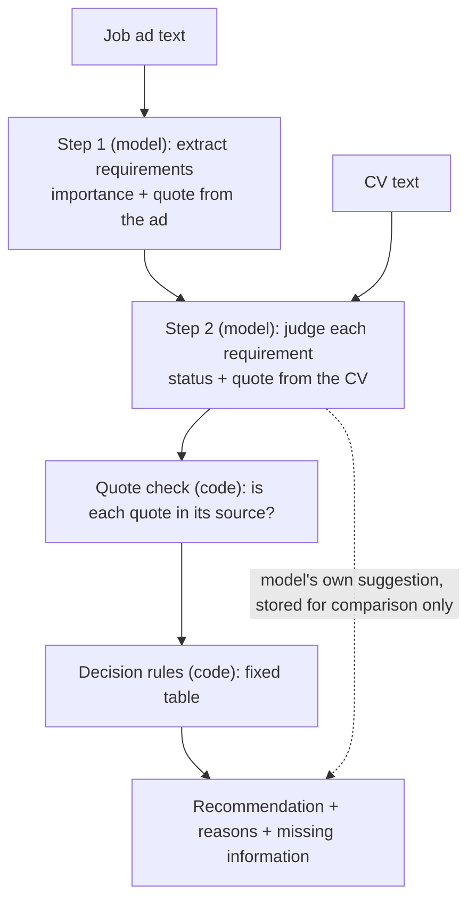

# Design: AI-assisted job-fit assessment

Status: **design v1, decisions made on 2026-11-13** (section 10). Nothing in this
document is built yet. Changes after this point are recorded in `DESIGN_LOG.md`.

This is activity 2 ("define the objectives for a solution") and the design half of
activity 3 in the design science research process of Peffers et al. (2007). The state
of the system before this work is recorded in [`docs/thesis/BASELINE.md`](../docs/thesis/BASELINE.md).

## 1. Decision problem

- **Who decides:** a recent IT graduate looking for a junior IT job.
- **The decision:** should I prioritise this vacancy?
- **The alternatives:** High Priority, Consider, Low Priority.
- **Why it is hard:** job ads list many skills without saying which are essential, and
  ask for "relevant experience" that is hard to judge when most of a graduate's
  experience comes from university projects.
- **What the system does:** it explains how the CV matches the ad, points out what is
  missing or unclear, and gives a recommendation with reasons. The choice stays with
  the job seeker.

The existing rule-based matcher answers a narrower question (how many known skill
terms overlap) with a number. It does not separate mandatory from preferred
requirements, and it cannot tell "the CV shows you lack this" from "the CV does not
say".

## 2. Objectives

Each objective is something the evaluation can check.

| # | Objective | Checked by |
|---|---|---|
| O1 | Identify the requirements in a job ad and mark each as mandatory, preferred or unclear | Review of practice and evaluation cases |
| O2 | For each requirement, say whether the CV meets it, and quote the CV text the judgement rests on | Automatic quote check; manual review sheet |
| O3 | Keep "not enough information" separate from "not met" | Scenario type 2 (unclear or missing information) |
| O4 | Derive the recommendation from the requirement judgements by documented, fixed rules | Unit tests on the rules; agreement with reference decisions |
| O5 | Give the same recommendation when the same CV and ad are assessed again | Repeated runs (scenario type 3) |
| O6 | Not change the recommendation because of irrelevant text, a different name on the CV, or instructions written inside an ad | Variant runs (scenario type 3) |
| O7 | Leave the user in control: runs only on request, states its limits, changes nothing by itself | Design review against Amershi et al. (2019) |
| O8 | Work on English and Swedish ads and CVs | Cases in both languages |
| O9 | Stay separate from the rule-based matcher, so both run on the same cases | Evaluation runner |

## 3. Requirements

Functional:

- **FR1** Input: one CV as text and one job ad as text.
- **FR2** Output: a recommendation (High Priority, Consider, Low Priority); a short
  summary; the list of requirements with importance, status and quoted evidence; a
  list of missing or unclear information; a "limited information" flag.
- **FR3** Every quote is checked against its source text. A quote that cannot be found
  is flagged, and a judgement that rests on it does not count as met.
- **FR4** Every assessment is stored with the model name, prompt version, rules
  version and the full model output.
- **FR5** In the app, an assessment starts only when the user asks for it, on one job
  at a time, and uses the user's default CV (the same CV the rule-based score uses).
- **FR6** The same service function is callable from the evaluation runner without
  the app or the database.

Non-functional:

- **Access:** administrators only until the evaluation is finished.
- **Cost:** about 0.02 USD per assessment with GPT-4o; a daily limit per user.
- **Time:** two model calls, 10 to 30 seconds; runs in the background worker.
- **Privacy:** the CV and ad text are sent to the model provider, as for CV tailoring
  today; the privacy policy is updated. The evaluation uses fictional CVs only.

## 4. Architecture

The model reads; code decides. The model is used for what rules cannot do (reading
free text in two languages). The decision itself is made by a rule table that can be
printed, tested and explained. This is the "structured decision logic combined with an
AI component" the thesis topic asks for.

Why two model calls and not one:

- Step 1 depends only on the ad, so the requirement list is not shaped by what the
  CV happens to contain.
- Errors can be located: a wrong recommendation is traced to a missed requirement
  (step 1), a wrong judgement (step 2) or the rules.

Where the code will live:

| Part | Location |
|---|---|
| Assessment logic (no database access) | `backend/app/services/fit_advisor/` |
| Storage, background task, API | `backend/app/models/fit_assessment.py`, `backend/app/tasks/fit_assessment.py`, `backend/app/api/v1/endpoints/fit_assessments.py`, migration `0035` |
| Panel in the app | `frontend/src/components/discover/fit/` |
| Cases, protocol, runner, results | `thesis/` |

## 5. Workflow in detail

### Step 1: requirements from the ad

For each requirement the model returns:

| Field | Values |
|---|---|
| `id` | R1, R2, ... |
| `text` | The requirement in one short English sentence |
| `category` | skill, experience, education, language, certification, other |
| `importance` | mandatory, preferred, unclear |
| `ad_quote` | The sentence or phrase in the ad, word for word, in the ad's language |

How importance is decided:

- **mandatory:** the ad says so ("must", "required", "you have", "krav", "ska ha",
  "vi kräver").
- **preferred:** the ad says so ("nice to have", "a plus", "meriterande", "gärna").
- **unclear:** the ad lists it without saying either.

### Step 2: evidence from the CV

For each requirement the model returns:

| Field | Values |
|---|---|
| `status` | met, partly_met, not_met, not_enough_information |
| `cv_quote` | The CV text the judgement rests on, word for word; empty if there is none |
| `note` | One sentence explaining the judgement |

It also returns a `summary` (two or three sentences), a list `missing_information`
(what the CV or the ad would need to say for a firmer answer), and its own
`model_recommendation`, which is stored but never shown as the result.

### Status definitions (decision Q1)

This is the most important definition in the design, because objective O3 depends on it.

| Status | Meaning |
|---|---|
| met | The CV states it. A quote is required. |
| partly_met | The CV shows something related but less than asked: a similar tool, or at least half of a stated amount of work experience. A quote is required. |
| not_met | The CV shows the candidate lacks it. Either the CV contradicts it (asks for a completed degree, CV says studies are ongoing), or it is a skill, tool or qualification that a CV normally lists and this CV does not mention it. |
| not_enough_information | The CV does not settle it, and it is something CVs often leave out (driving licence, work permit, language level, willingness to travel), or the requirement itself is too vague to judge ("relevant experience", "good communication skills"). |

Amended on 2026-11-14 (prompt version 5, see `DESIGN_LOG.md`): when a requirement states
an amount of work experience, the work periods in the CV are added up, an internship
counting for its length. The total reaching the amount is met, at least half of it is
partly met, and less than half, or no relevant work, is not met.

The alternative considered was to call every unmentioned requirement "not enough
information". It was rejected: a CV with none of the required technologies could then
never be Low Priority, which contradicts the "clear mismatch" scenario in the
research report.

### Quote check

Code compares every `ad_quote` with the ad and every `cv_quote` with the CV, ignoring
case and differences in spacing.

- A `met` or `partly_met` whose CV quote is not found in the CV is changed to
  `not_enough_information` and flagged.
- An `ad_quote` not found in the ad flags the requirement as unverified; it stays in
  the list but is marked.
- The share of quotes that pass is a transparency measure in the evaluation.

### Decision rules, version 1 (decisions Q2 to Q4)

Applied in this order, to the mandatory requirements, after the quote check:

| # | Condition | Recommendation |
|---|---|---|
| 1 | At least one mandatory requirement is `not_met` | Low Priority |
| 2 | There is at least one mandatory requirement and every one is `met` | High Priority |
| 3 | Anything else | Consider |

"Anything else" covers: a mandatory requirement that is `partly_met` or
`not_enough_information`, and an ad with no requirement marked mandatory.

The **limited information** flag is set when a third or more of the mandatory
requirements are `not_enough_information`, or when the ad has no mandatory
requirement. It is shown next to the recommendation and does not change it.

Preferred and unclear requirements do not change the recommendation in version 1.
They are shown and counted in the summary ("3 of 5 preferred requirements met").

Alternatives considered and not chosen for version 1:

- Low Priority only when half or more of the mandatory requirements are not met.
  Rejected because one unmet essential requirement is what the research report calls
  a clear mismatch, and a single rule is easier to explain to the user.
- Requiring half of the preferred requirements for High Priority. Rejected to keep
  the rules to the distinction the report stresses: mandatory against preferred.
- Treating an unclear requirement as mandatory. Rejected because it would turn vague
  ads into Low Priority results, when the honest answer is that the ad does not say.

### Worked examples

| Case | Mandatory requirements after the quote check | Result |
|---|---|---|
| Ad requires Python, SQL and a bachelor's degree; the CV states all three | met, met, met | High Priority |
| Same ad; the CV has Python and SQL, and says the degree is unfinished | met, met, not_met | Low Priority |
| Same ad; the CV has Python, mentions "databases" but not SQL, has the degree | met, partly_met, met | Consider |
| Ad requires Java and a driving licence; the CV has Java, says nothing about a licence | met, not_enough_information | Consider, limited information |
| Ad lists skills without saying which are required | (none) | Consider, limited information |

## 6. Interaction design

The panel sits in the job detail view in Discover, under the existing match score,
which is not changed. The design follows Amershi et al. (2019):

| Guideline | How the panel meets it |
|---|---|
| G1 Make clear what the system can do | One line above the button: it reads this ad and your default CV, and nothing else |
| G2 Make clear how well it can do it | "It can be wrong. Check the quoted evidence." The limited-information notice |
| G6 Mitigate social biases | The prompt tells the model to ignore name, age, gender, nationality and photo; name-swap cases test it |
| G7 Support efficient invocation | One button, on the job the user is already looking at |
| G8 Support efficient dismissal | The panel collapses; nothing else on the page depends on it |
| G10 Scope services when in doubt | "Not enough information" and Consider, never a guess presented as certain |
| G11 Make clear why it did what it did | Requirement table with importance, status and the quoted text; the rule that produced the recommendation is named |
| G12 Remember recent interactions | A stored assessment is shown again without a new model call |

Left for later: G9 (letting the user correct a requirement's status, after which the
rules would recompute the recommendation with no new model call) and G15 (feedback
buttons).

The panel always shows: "This is a recommendation. The decision is yours."

## 7. Reproducibility

- One dated GPT-4o snapshot (for example `gpt-4o-2024-08-06`), the same for the
  whole evaluation. Temperature 0 and a fixed seed.
- `PROMPT_VERSION` and `RULES_VERSION` are stored with every assessment.
- Every change to a prompt or a rule gets an entry in `thesis/DESIGN_LOG.md`: what
  changed, why, and which practice case showed the need. This is the "design as a
  search process" of Hevner et al. (2004), kept visible.
- The prompts are tuned only on practice cases. The evaluation cases are written by
  the thesis author, kept outside the repository, and added only after the prompts
  and rules are frozen and tagged.

## 8. Evaluation design

The full procedure will be in `thesis/README.md` and `thesis/protocol.yaml`. This
section fixes the design; nothing here has been run.

### Strategy

Following FEDS (Venable, Pries-Heje & Baskerville, 2016), the strategy is **Technical
Risk & Efficacy**: the main design risk is technical (can a language model judge
requirements reliably?), and evaluating with real job seekers is out of reach for
this project. Evaluation is therefore artificial throughout, in two kinds of episode:

| Episode | Purpose (FEDS) | Material | Use of the result |
|---|---|---|---|
| During the build | Formative | Practice cases written by the developer | Improve prompts and rules; every change logged |
| After the freeze | Summative | Evaluation cases written by the thesis author | Reported in the thesis; no changes afterwards without a new version |

In the terms of Hevner et al. (2004, Table 2) the methods are simulation with
artificial data, functional black-box testing, and scenarios.

### Cases

- Fictional CV and job ad pairs for junior IT roles, in English and Swedish, across
  three scenario types: clear match or mismatch; unclear or missing information;
  consistency and robustness.
- The number of cases (12 to 18 in the research report) is to be justified by the
  comparisons intended: scenario type by language by expected priority. The runner
  reports per cell, so thin cells are visible.

### Reference decisions, independent of both systems

- Each case has a reference decision (High Priority, Consider, Low Priority) with a
  written rationale, made by reading the CV and the ad, **before either system runs**.
- The criteria for reference decisions are written for a human reader. They are not a
  copy of the rule-based matcher's formula, and not a copy of the rule table in
  section 5.
- A second person labels the same cases without seeing the first labels or either
  system's output. Agreement is reported; disagreements are recorded and resolved by
  discussion, and the resolution is logged.
- The evaluation cases are kept outside the repository, and away from the developer
  of the prompts, until the prompts and rules are frozen and tagged.

A limitation to state openly: the component's rules and the reference criteria share
the idea that mandatory requirements weigh most. That is the design objective, but it
means agreement with the reference partly reflects a shared view of the problem. The
second labeller and the separately written criteria reduce this; they do not remove it.

### The baseline on the same cases

The rule-based matcher runs unchanged on the same pairs. Its score is turned into a
priority by thresholds fixed here, before any result exists, and justified from the
formula (see `docs/thesis/BASELINE.md`), not from outcomes:

| Score | Skills part | Priority |
|---|---|---|
| 86 or more | 80 or more: all or nearly all of the ad's recognised skills are in the CV (3 of 3, 4 of 4, 5 of 6) | High Priority |
| 70 to below 86 | 40 to below 80: a good part of them (2 of 3, 3 of 5, 4 of 5) | Consider |
| Below 70 | Below 40: half or fewer with little evidence (1 of 2, 2 of 4), or no recognised skill in the ad (66) | Low Priority |

### Measures

Correctness and consistency are measured separately: a system can be consistently wrong.

| Property | Measure |
|---|---|
| Correctness | Agreement with the reference decision, per system, scenario type and language; a miss by one step is reported apart from an opposite result |
| Consistency | Share of the 5 repeated runs of a case that give the same priority, whether or not it is the correct one |
| Robustness | Share of cases whose priority changes under each variant (irrelevant text in the ad, in the CV, a changed name, an instruction inside the ad), 3 runs each |
| Transparency | Share of quotes that pass the check; a review sheet on which each explanation is judged as supported by the texts or not |
| Missing or ambiguous information | Whether the information the case was built to lack is flagged; how often the limited-information flag is set |
| Reliability | Failed calls, invalid outputs, time and cost per assessment |

Every wrong recommendation and every unsupported explanation is listed with the full
output of both systems, for the failure-case analysis.

### Validity and limits

- Fictional cases written by one person may not represent real ads and CVs; findings
  hold for these scenarios and are an initial evaluation, not proof of general
  performance.
- The sample is small: results are counts and percentages, without significance tests.
- The model is a hosted service. The model snapshot, temperature, seed, prompt and
  rules versions are stored with every run, but the provider can change behaviour
  behind a snapshot name; repeated runs measure this, they do not prevent it.
- No user study: usefulness to real job seekers is argued from the design, not measured.

## 9. Out of scope

- Changing the rule-based matcher.
- Assessing many jobs at once, or re-ranking the Discover feed.
- Training or fine-tuning a model.
- A user study. The empirical material is controlled test runs.
- Real applicants' CVs in the evaluation.

## 10. Decisions

Made by the thesis author on 2026-11-13.

| # | Question | Decision |
|---|---|---|
| Q1 | A required skill is not mentioned in the CV | `not_met` for skills, tools and qualifications; `not_enough_information` for things CVs often omit |
| Q2 | Is one unmet mandatory requirement enough for Low Priority? | Yes |
| Q3 | Do preferred requirements affect the recommendation? | No, they are shown only |
| Q4 | Does an unclear requirement count as mandatory or preferred? | Preferred |
| Q5 | Repeated runs | 5 per case, 3 per variant |
| Q6 | Thresholds for the rule-based score | By skill coverage: High at 86 or more, Low below 70 (section 8) |
| Q7 | Who checks the reference decisions? | A second person, labelling blind |

Still open, for the supervisor meeting: the final number of cases and how it is
justified; who the second labeller is.

## References

- Amershi, S., Weld, D., Vorvoreanu, M., et al. (2019). Guidelines for human-AI
  interaction. *Proceedings of the 2019 CHI Conference on Human Factors in Computing
  Systems*. https://doi.org/10.1145/3290605.3300233
- Hevner, A. R., March, S. T., Park, J., & Ram, S. (2004). Design science in
  information systems research. *MIS Quarterly, 28*(1), 75–105.
- Peffers, K., Tuunanen, T., Rothenberger, M. A., & Chatterjee, S. (2007). A design
  science research methodology for information systems research. *Journal of
  Management Information Systems, 24*(3), 45–77.
- Venable, J., Pries-Heje, J., & Baskerville, R. (2016). FEDS: A framework for
  evaluation in design science research. *European Journal of Information Systems,
  25*(1), 77–89. https://doi.org/10.1057/ejis.2014.36
